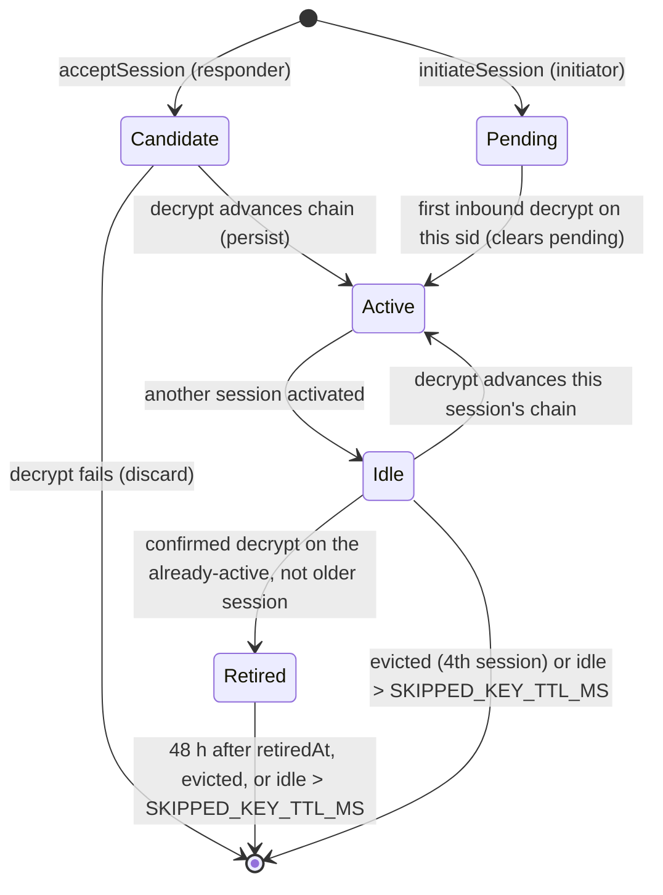

# brnr-e2ee protocol specification

Status: implemented by brnr-e2ee 1.x. Suites `x25519-xchacha20poly1305-sha256-v2` (preferred, from 1.1.0) and `x25519-xchacha20poly1305-sha256-v1`, wire `v: 2`. In this document "v1" and "v2" alone name these suites; "v1 only" and "v2 only" mark text that applies to one suite.

**This protocol and its implementation have not had an independent security audit.**

This document is normative. It is written so that a second implementation can be built from it alone and match the library byte for byte; `scripts/ref/` is such an implementation, and CI checks that it agrees with the vectors. §20 records the design decisions made while the library was implemented.

---

## 1. Conventions

- MUST, MUST NOT and SHOULD are used as in RFC 2119.
- `a ‖ b` is byte concatenation. `x[i..j]` is bytes `i` to `j−1`.
- `"text"` in a byte expression is the ASCII bytes of the text, without a terminator.
- `u16be(x)`, `u32be(x)` and `u64be(x)` are unsigned big-endian integers of 2, 4 and 8 bytes.
- `lp(x) = u16be(len(x)) ‖ x`. `len(x)` MUST be < 65,536.
- `0^n` is `n` zero bytes. `0xFF^n` is `n` bytes of `0xFF`.
- `B64u` is base64url (RFC 4648 §5) without padding.
- "Raw bytes" means the decoded bytes of a B64u value. Byte strings are compared as unsigned bytes, lexicographically, never as B64u text.
- In a byte expression, a key, signature, nonce, digest or `ephNew`/`ephOld` stands for its raw decoded bytes. `u32be(b)` applied to a 4-byte string means its big-endian integer value. Text fields (`deviceId`, `requestId`, `accountId`) enter as their UTF-8 bytes, never decoded.
- `now()` is the injected clock (`E2eeOptions.now`, default `new Date()`), in milliseconds since the Unix epoch.

## 2. Scope

The library provides:

- X3DH key agreement (§6);
- the Double Ratchet (§7);
- Sesame-style management of several sessions per peer device (§8);
- signed device bundles and device lists (§5);
- safety numbers (§12);
- a device-link ceremony (§13);
- report disclosure (§14).

It holds no storage and makes no network calls. Persistence goes through the `KeyStore` the caller implements (§10).

Deferred, not in 1.x: header encryption (DR §4), PQXDH and post-quantum ratchets, the Sesame multi-device send loop and self-sync, key backup and history sync, groups (MLS), sealed sender, message franking, key transparency, and an independent security audit.

## 3. Primitives

| Role      | Primitive                                                                   | Implementation                                   |
| --------- | --------------------------------------------------------------------------- | ------------------------------------------------ |
| DH        | X25519 (RFC 7748)                                                           | `@noble/curves/ed25519.js` `x25519`              |
| Signature | Ed25519 (RFC 8032), verify with `zip215: false`                             | `@noble/curves/ed25519.js` `ed25519`             |
| AEAD      | XChaCha20-Poly1305 (draft-irtf-cfrg-xchacha-03), 24-byte nonce, 16-byte tag | `@noble/ciphers/chacha.js` `xchacha20poly1305`   |
| Hash      | SHA-256, SHA-512                                                            | `@noble/hashes/sha2.js`                          |
| MAC / KDF | HMAC-SHA256 (RFC 2104), HKDF-SHA256 (RFC 5869)                              | `@noble/hashes/hmac.js`, `@noble/hashes/hkdf.js` |

`src/primitives.ts` is the only module that imports `@noble/*`. No other primitive is used. XEdDSA is not used: devices hold separate Ed25519 and X25519 keys.

`HKDF(salt, ikm, info, L)` is RFC 5869 extract-then-expand with SHA-256.

## 4. Encodings and input rules

Every rule here is checked on input. A failure raises the code given; nothing is defaulted.

### 4.1 base64url

- Decoding MUST reject padding, characters outside `[A-Za-z0-9_-]`, and any string that does not re-encode to itself. That rules out non-zero trailing bits.
- Fixed-length fields MUST decode to exactly the stated length. Keys are 32 bytes, signatures 64, nonces 24, `sid` 8, digests 32. The length is checked on the string before decoding: a field of `n` bytes MUST be exactly `ceil(4n / 3)` characters, which for a canonical string is equivalent.
- Failure → `E2EE_INVALID_INPUT` for wire structs, `E2EE_INVALID_STATE` for state. A key field of the wrong decoded length is such a failure. `E2EE_INVALID_KEY` is raised only by the §4.2 point checks and the all-zero X25519 check.

### 4.2 Keys

- **X25519 public keys** are 32 bytes and MUST be canonical: bit 255 is clear and the little-endian `u` is below `p = 2^255 − 19`. RFC 7748 masks bit 255 and reduces `u`, so a non-canonical key computes the same DH as its canonical form but hashes differently (a second handshake digest, sid or replay-set entry for one key). This is an encoding rule, checked when the key is decoded: every box key, SPK, OTP, handshake key, ratchet key (`header.dh`, `dhs.pk`, `dhr`, `prevRemoteDh`, `skipped[].dh`), device-list `deviceBoxPk` and link ephemeral or box key. Failure → `E2EE_INVALID_INPUT` (wire or parameter) or `E2EE_INVALID_STATE` (state, key pairs), as for a wrong length (§4.1); `verifyLinkCommitment` returns `false`.
- An X25519 result that is all zero → `E2EE_INVALID_KEY`. This rejects low-order peer keys.
- **Ed25519 public keys** are 32 bytes. They MUST decode to a curve point (`Point.fromBytes`, strict), and the point MUST NOT be of small order (`isSmallOrder()`). Otherwise → `E2EE_INVALID_KEY`.
- **Private keys** are 32 bytes. An Ed25519 private key is the RFC 8032 seed. An X25519 private key is the scalar before clamping.

### 4.3 Identifiers

- Opaque ids are 1 to 128 bytes matching `^[A-Za-z0-9._:-]+$`: `conversationId`, `senderDeviceId`, `deviceId`, `accountId`, `envelopeId` and `requestId`.
- `stableId`, used only for fingerprints, is 1 to 256 bytes of well-formed UTF-8.

### 4.4 Integers

- Integers are JSON numbers that are safe integers. `-0` is not an integer anywhere: state → `E2EE_INVALID_STATE`, wire → `E2EE_INVALID_INPUT` (rule 4), `canonicalJson` → `E2EE_INVALID_INPUT`.
- `spkId`, `otpId` and `epoch` are in `[1, 2^31−1]`.
- `n`, `pn` and state counters are in `[0, 2^31−1]`.
- A **received** `n` MUST be ≤ 2^31−2, so `Nr = n + 1` always fits. A received `pn` MUST be ≤ 2^31−1 (a sender's `PN` can reach 2^31−1).

### 4.5 Timestamps

A timestamp is a string matching `^\d{4}-\d\d-\d\dT\d\d:\d\d:\d\d\.\d{3}Z$` that also satisfies all of these:

- year in [2000, 9999];
- month in [1, 12];
- day valid for the month, with Gregorian leap years;
- hour in [0, 23], minute in [0, 59], second in [0, 59] (no leap second);
- `new Date(ms).toISOString() === s`, where `ms` is the parsed value.

Implementations MUST NOT rely on `Date.parse`: they take the fields from the pattern above, compute `ms` with `Date.UTC` (or equivalent), check the year bounds, and require the exact round trip. `ms(s)` is that integer, always ≥ 0. Failure → `E2EE_INVALID_INPUT` (wire) or `E2EE_INVALID_STATE` (state).

### 4.6 Canonical JSON (JCS)

`JCS(x)` is RFC 8785, restricted to:

- objects, arrays and strings;
- integers in [0, 2^31−1].

Object keys are sorted by UTF-16 code units. Properties whose value is `undefined` are omitted. `null`, booleans, non-integers and negative numbers are not allowed in any signed or hashed value. Every string has already passed its field's rule, so lone surrogates cannot occur. Output is the UTF-8 encoding of the JCS text. The library exports `canonicalJson(value)` for servers.

### 4.7 Strict objects

Every wire and state struct is parsed with a strict schema: no unknown keys, all required keys present, correct types. Checks run in this order, and the first failure wins:

0. the input is not a JSON object → `E2EE_INVALID_INPUT` (wire) or `E2EE_INVALID_STATE` (state);
1. top-level `v` missing or unknown → `E2EE_UNSUPPORTED_VERSION`;
2. the `v` of each nested struct (`handshake`, `ad`), depth-first in key order → `E2EE_UNSUPPORTED_VERSION`;
3. `suite` fields of a message (`suite`, `ad.suite`) not in `SUITES` → `E2EE_UNSUPPORTED_SUITE`;
4. anything else → `E2EE_INVALID_INPUT` for wire structs (with `details.path`), `E2EE_INVALID_STATE` for state.

Key-pair structs passed to the library (§5.2: `self`, values returned by `lookupSpk` and `lookupOtp`, the account key) and stored trackers count as state. Device-list entry count and `deviceId` uniqueness failures → `E2EE_DEVICE_LIST_INVALID`. More than `MAX_DEVICES` entries is checked after rule 3 and before rule 4 (and before `buildSignedDeviceList` validates its `devices`), so an oversized list is rejected without walking its entries. Every array in a wire or state struct has an upper bound, checked by its schema before its elements. `parseMessage` also enforces `len(JCS(message)) ≤ MAX_WIRE_BYTES`, after rule 4.

- **Nested structs in state.** In a session state, each `sessions[i].founding` is a nested handshake for rule 2.
- **Received counters.** `parseMessage` checks `n ≤ 2^31−2` and `pn ≤ 2^31−1` (§4.4) as part of rule 4.
- **Rules 2 and 3.** Rule 3 fires for any present value not in `SUITES`, including non-strings; an absent `suite` fails rule 4. A nested struct (an object) without `v` fails rule 2.
- **Suite shapes.** A message is checked by rule 4 against the shape of its `suite`: the v2 shape when `suite` is `x25519-xchacha20poly1305-sha256-v2`, the v1 shape otherwise. Each shape fixes `ad.suite` to the message's `suite` and fixes the AD and handshake fields (§6.1, §7.4), so a v1 message whose `ad.suite` is v2, or a v2 message carrying a v1 AD, fails rule 4. A handshake given alone (`handshakeDigest`) or stored in a state (`founding`) has the v2 shape if it has an own `initiatorSignPk` key, and the v1 shape otherwise. The two shapes share `v: 2` (§18).
- **String input.** `parseMessage`, `parseBundle` and `parseDeviceList` accept a parsed object or its JSON text. Text is parsed with `JSON.parse` first; a syntax error → `E2EE_INVALID_INPUT` (`E2EE_DEVICE_LIST_INVALID` is not used for it).

### 4.8 Parameters, callbacks and the clock

- **Parameter order.** Before its numbered steps, each function validates its plain parameters in signature order. Key-pair structs (`self`, `device`, `account`, `spk`, `ephSelf`) → `E2EE_INVALID_STATE`. Ids, keys, integers, strings and byte arrays → `E2EE_INVALID_INPUT`. An explicit `suite` → `E2EE_UNSUPPORTED_SUITE`. Wire structs (`message`, `peerBundle`, `list`) and `existing` are parsed where their step says. `decrypt` parses `state` (with the §9.2a exception) before step 1, as `encrypt` does. `withSession` validates `peerDeviceId` and `conversationId` before taking the lock.
- **Ed25519 keys.** The §4.2 point check applies to every Ed25519 public key the library receives, including `computeSafetyNumber` and `linkTranscript` inputs. Pins (`pinnedAccountSignPk`, `expectedPeerBoxPk`, `expectedPeerSignPk`) are only checked for base64url and length (`E2EE_INVALID_INPUT`). So are the v2 handshake keys `initiatorSignPk` and `responderSignPk` and the state's `selfSignPk` and `peerSignPk`: the library only compares them with pins or its own key and hashes them, and never verifies a signature with them.
- **Callbacks.** `seenHandshake` must return a boolean, else `E2EE_INVALID_STATE`. An exception thrown by `lookupSpk`, `lookupOtp`, `seenHandshake` or `now` is caller code and propagates unchanged, as in §10.2. An exception thrown by `rng` → `E2EE_RNG_UNAVAILABLE`.
- **Clock.** A function that reads the clock reads it once, at its start, before any parameter validation. If `now()` does not return a `Date` whose `toISOString()` passes §4.5 → `E2EE_INVALID_INPUT`.
- **Boolean verifiers.** `verifySafetyNumberPayload`, `verifyLinkCommitment` and `verifyReportDisclosureItem` return `false` for any malformed argument and never throw.
- **Caller mistakes.** A callback or `fn` that is not a function → `E2EE_INVALID_INPUT`. A malformed `expectedAd` → `E2EE_AD_MISMATCH`. `fn` returning a non-object → `E2EE_INVALID_INPUT`. A getter or Proxy on caller input that throws while being read → `E2EE_INVALID_INPUT` for wire structs and parameters, `E2EE_INVALID_STATE` for state.
- **Undefined-valued properties.** Strict parsing rejects an explicitly `undefined` property on a wire or state object. The JCS rule that omits them (§4.6) applies only to `canonicalJson` output.
- **Plain objects.** A plain object has the prototype `Object.prototype` or `null`; `Map`, `Date` and class instances are not plain objects. This applies to `canonicalJson`, to the `fn` result in §10.2, and to §4.7 rule 0 for every wire and state struct, including nested ones (`header`, `ad`, `handshake`, `otp`, each session and its own nested structs). A nested struct that is not plain → the struct's §4.7 error code.
- **Reading parameters.** A getter that throws while the parameters object itself is read → `E2EE_INVALID_INPUT`, whatever the field; a throw inside a key-pair struct → `E2EE_INVALID_STATE`. An `rng` that is not a function → `E2EE_RNG_UNAVAILABLE` (§15). `opts.dangerouslyAllowTestRng` is read with `rng` and `now`; only the value `true` opts in (§15). In `E2eeOptions`, an `rng` or `now` that is `undefined` or `null` means absent, so the default applies; `opts` that is not `undefined`, `null` or an object → `E2EE_INVALID_INPUT`.
- **`fn` results.** A getter or Proxy trap that throws while `withSession` reads the object `fn` returned is caller code and propagates unchanged, like any error thrown by `fn` (§10.2).
- **`canonicalJson`** also rejects sparse arrays and nesting deeper than 32 levels (`E2EE_INVALID_INPUT`).
- `bundleMatchesDeviceList` parses both arguments and throws on malformed input. `buildReportDisclosure` requires at least one item, else `E2EE_INVALID_INPUT`.

## 5. Keys, bundles and device lists

### 5.1 Labels

Every label is ASCII. Changing any of them requires a new suite id.

| Label                     | Used in                           |
| ------------------------- | --------------------------------- |
| `e2ee/v2/boxpk`           | `deviceBoxPkSig`                  |
| `e2ee/v2/spk`             | `spkSig`                          |
| `e2ee/v2/device-list`     | device-list signature             |
| `e2ee/v2/x3dh`            | X3DH KDF info                     |
| `e2ee/v2/rk`              | KDF_RK info                       |
| `e2ee/v2/mk`              | message-key expansion info prefix |
| `e2ee/v2/sid`             | session id                        |
| `e2ee/v2/hs-digest`       | handshake digest                  |
| `e2ee/v2/link-transcript` | link transcript                   |
| `e2ee/v2/link-commit`     | link commitment                   |
| `e2ee/v2/link-code`       | link confirmation code            |
| `e2ee/v2/link-seal`       | sealed account key                |
| `e2ee/s2/x3dh`            | X3DH KDF info prefix, v2 only     |
| `e2ee/s2/rk`              | KDF_RK info, v2 only              |
| `e2ee/s2/mk`              | message-key expansion, v2 only    |

The `e2ee/v2/x3dh`, `e2ee/v2/rk` and `e2ee/v2/mk` labels are used by v1 only; every other label is shared by both suites. The `v2` in the older labels is the wire version, not the suite. No label is a prefix of another label followed by bytes that could be mistaken for a different payload. Every signed payload starts with a distinct label.

### 5.2 Key structs (`v: 1`)

```ts
AccountIdentityKeyPair { v: 1; signPk: B64u; signSk: B64u }                     // Ed25519
DeviceIdentityKeyPair  { v: 1; deviceId; signPk; signSk; boxPk; boxSk }          // Ed25519 + X25519
SignedPrekeyPair       { v: 1; spkId; pk; sk; sig; createdAt; suites: string[] }  // X25519
OneTimePrekeyPair      { v: 1; otpId; pk; sk }                                   // X25519
```

Generation draws one `seed` of 32 bytes per key pair (§15).

- **Ed25519:** `signSk = seed`, `signPk = ed25519.getPublicKey(seed)`.
- **X25519:** `sk = seed`, `pk = x25519.getPublicKey(seed)`.

`generateDeviceIdentity` draws the signing seed first, then the box seed.

- `generateSignedPrekey(device, spkId, suites = SUITES)` (so by default `[v2, v1]`) sets `createdAt = new Date(now()).toISOString()`, which MUST pass §4.5 (else `E2EE_INVALID_INPUT`), and signs per §5.3.
- `generateOneTimePrekeys(first, count)`: `count ∈ [1, 1000]` and `first + count − 1 ≤ 2^31−1`, else `E2EE_INVALID_INPUT`.
- Consumers MUST NOT reuse an `spkId` or `otpId` on a device (§19).

### 5.3 Signatures on device keys

```
deviceBoxPkSig = Ed25519.sign(deviceSignSk, "e2ee/v2/boxpk" ‖ lp(UTF-8(deviceId)) ‖ deviceBoxPk)
spkSig         = Ed25519.sign(deviceSignSk, "e2ee/v2/spk" ‖ lp(UTF-8(deviceId)) ‖ u32be(spkId) ‖ spkPk
                                              ‖ u64be(ms(createdAt)) ‖ lp(JCS(suites)))
```

`suites` is the SPK's ordered suite list, preferred first. It is non-empty, without duplicates, and has at most 8 entries. Each entry matches `^[a-z0-9-]{1,64}$`.

### 5.4 Device bundle (`v: 2`)

```ts
DeviceBundleV2 {
  v: 2; suites: string[]; deviceId; deviceSignPk; deviceBoxPk; deviceBoxPkSig;
  spkId; spkPk; spkSig; otp?: { otpId; pk }; createdAt
}
```

- `buildDeviceBundle({ device, spk })` copies `suites` and `createdAt` from the SPK. The server serves `suites` from the stored SPK row, never from device-level data.
- **`verifyDeviceBundle`** checks, in order:
  1. strict parse (§4.7);
  2. key validity (§4.2);
  3. `deviceBoxPkSig` verifies under `deviceSignPk`;
  4. `spkSig` verifies over the §5.3 payload built from the bundle's `deviceId`, `spkId`, `spkPk`, `createdAt` and `suites`.

  Any failure in steps 3-4 → `E2EE_BUNDLE_SIGNATURE_INVALID`.

- `otp` is not signed. A server that substitutes it causes `E2EE_OTP_UNKNOWN`, a denial of service. A server that omits it forces 3-DH, whose founding message is replayable; §8.6 covers that.
- **Unknown suite ids** in `suites` are accepted when they match the format rule, and are ignored when choosing a suite (forward compatibility).
- **Choosing a suite.** `initiateSession` picks the first entry of `suites` that is in `SUITES`. If there is none → `E2EE_UNSUPPORTED_SUITE`.
- **Downgrade.** `spkSig` covers `suites`, so a server cannot remove v2 from a bundle it serves (`E2EE_BUNDLE_SIGNATURE_INVALID`). It can still serve an older SPK of the same device whose list lacks v2, while that SPK exists; and the owner of a bundle chooses its list. §6.5 says what this means for the unknown-key-share defence.

### 5.5 Signed device list (`v: 1`)

```ts
SignedDeviceList {
  v: 1; accountId; accountSignPk; epoch;
  devices: Array<{ deviceId; deviceSignPk; deviceBoxPk; addedAt; revokedAt? }>;  // 1..64 entries, unique deviceId
  sig
}
signingBytes(list) = "e2ee/v2/device-list" ‖ 0x00 ‖ JCS(list without sig)
sig                = Ed25519.sign(accountSignSk, signingBytes(list))
deviceListDigest   = b64u(SHA-256(signingBytes(list)))
```

**`verifySignedDeviceList(list, { pinnedAccountSignPk?, minEpoch? })`** checks, in order:

1. strict parse;
2. key validity;
3. `revokedAt ≥ addedAt` when present, else `E2EE_DEVICE_LIST_INVALID`;
4. if `pinnedAccountSignPk` is given and differs (raw bytes) → `E2EE_IDENTITY_MISMATCH`;
5. the signature verifies, else `E2EE_DEVICE_LIST_INVALID`;
6. if `minEpoch` is given and `epoch < minEpoch` → `E2EE_DEVICE_LIST_INVALID` (rollback).

`bundleMatchesDeviceList(bundle, list)` is true iff some entry without `revokedAt` has an equal `deviceId`, `deviceSignPk` and `deviceBoxPk` (raw bytes). It does not verify the list; the caller verifies it first.

Two different lists with the same `epoch` can only come from the holder of the account key. Callers that want to detect this pin `(epoch, deviceListDigest)`.

## 6. X3DH (X3DH §3)

### 6.1 Handshake (`v: 2`)

```ts
// v1 shape
HandshakeV2 { v: 2; initiatorBoxPk: B64u; initiatorEphPk: B64u; spkId: number; otpId?: number }
// v2 shape: the v1 fields plus the initiator's signing key and the responder identity it targeted
HandshakeV2 { v: 2; initiatorBoxPk: B64u; initiatorSignPk: B64u; initiatorEphPk: B64u;
              responderDeviceId: string; responderSignPk: B64u; spkId: number; otpId?: number }
hsDigest(h) = b64u(SHA-256("e2ee/v2/hs-digest" ‖ JCS(h)))
sid(h)      = b64u(SHA-256("e2ee/v2/sid" ‖ JCS(h))[0..8])
```

- `initiatorSignPk` is the initiator's Ed25519 device key (`self.signPk`), `responderDeviceId` and `responderSignPk` are the `deviceId` and `deviceSignPk` of the bundle the initiator used. All three are required in the v2 shape and absent from the v1 shape (§4.7).
- `hsDigest` and `sid` are the same functions in both suites. The two shapes have different key sets, so no v1 handshake has the JCS bytes of a v2 handshake.

The library exports `handshakeDigest(h) = hsDigest(h)`, so callers never reimplement it (§6.4). It accepts either shape.

### 6.2 Shared secret

IK_A and EK_A belong to the initiator. IK_B, SPK_B and OPK_B belong to the responder.

```
DH1 = X25519(IK_A.sk, SPK_B)       DH2 = X25519(EK_A.sk, IK_B)
DH3 = X25519(EK_A.sk, SPK_B)       DH4 = X25519(EK_A.sk, OPK_B)     (only when otpId is present)
SK  = HKDF(salt = 0^32, ikm = 0xFF^32 ‖ DH1 ‖ DH2 ‖ DH3 [‖ DH4], info = info(suite), L = 32)

info(v1) = "e2ee/v2/x3dh"
info(v2) = "e2ee/s2/x3dh" ‖ id(A) ‖ id(B)
id(X)    = lp(UTF-8(X.deviceId)) ‖ X.signPk ‖ X.boxPk          (32-byte raw keys)
```

`A` is the initiator and `B` the responder, each as `{ deviceId, signPk (Ed25519), boxPk (X25519) }`, always in that order. Each side takes them from its own view:

| Side      | `A`                                                                                  | `B`                                                                        |
| --------- | ------------------------------------------------------------------------------------ | -------------------------------------------------------------------------- |
| Initiator | `self.deviceId`, `self.signPk`, `self.boxPk`                                         | `peerBundle.deviceId`, `peerBundle.deviceSignPk`, `peerBundle.deviceBoxPk` |
| Responder | `message.ad.senderDeviceId`, `handshake.initiatorSignPk`, `handshake.initiatorBoxPk` | `self.deviceId`, `self.signPk`, `self.boxPk`                               |

If the two sides disagree on any of the six fields, `SK`, and so every key derived from it, differs.

The responder computes the mirror values: `DH1 = X25519(SPK_B.sk, IK_A)`, and so on. Each DH output is checked (§4.2).

- 4-DH is used **if and only if** the handshake carries `otpId`.
- A responder that cannot resolve the `otpId` fails with `E2EE_OTP_UNKNOWN`. It never falls back to 3-DH (D5).
- `Encode(PK)` (X3DH §2.1) is the raw 32-byte X25519 key, with no type byte.
- The X3DH associated data `IK_A ‖ IK_B` is bound into every message key (§7.4), not only the first message (X3DH §3.3). In v2 the Ed25519 device keys are bound there too.

### 6.3 `initiateSession({ conversationId, self, peerBundle, suite?, existing? })`

1. Parse `peerBundle` and run `verifyDeviceBundle`.
2. `peerBundle.deviceBoxPk ≠ self.boxPk`, else `E2EE_INVALID_INPUT` (reflection).
3. Choose the suite (§5.4). An explicit `suite` must be in both lists, else `E2EE_UNSUPPORTED_SUITE`.
4. With `existing` (parsed as state):
   - `existing.peerBoxPk == peerBundle.deviceBoxPk`, `existing.selfBoxPk == self.boxPk` (raw bytes), `existing.selfDeviceId == self.deviceId` and `existing.peerDeviceId == peerBundle.deviceId`, and, if `existing` has `peerSignPk`, `existing.peerSignPk == peerBundle.deviceSignPk` and `existing.selfSignPk == self.signPk`, else `E2EE_IDENTITY_MISMATCH`;
   - `existing.conversationId == conversationId`, else `E2EE_INVALID_INPUT`;
   - the chosen suite is not older than `existing.suite` (§9.1: a state never moves to an older suite), else `E2EE_UNSUPPORTED_SUITE`.
5. Draw `ek` (32), then `dhs` (32) (§15). Compute `SK` (§6.2).
6. `handshake = { v: 2, initiatorBoxPk: self.boxPk, initiatorEphPk: EK_A.pk, spkId, otpId? }`, where `otpId = peerBundle.otp?.otpId`. In v2 it also carries `initiatorSignPk = self.signPk`, `responderDeviceId = peerBundle.deviceId` and `responderSignPk = peerBundle.deviceSignPk`.
7. Build the initiator session (§7.2) with `sid = sid(handshake)`, `createdAt = lastUsedAt = now` and `pending = { createdAt: now }`.
8. With `existing`, evict per §9.1 if there are already 3 sessions, then append the new session. Without `existing`, create a new state (§9). Set `activeSid` to the new sid and the state's `suite` to the chosen suite. In v2, set `selfSignPk = self.signPk` and `peerSignPk = peerBundle.deviceSignPk` (a new v1 state has neither; with `existing` they already hold these values or are absent). Apply §9.3.

The initiator does not record its own handshake in `acceptedHandshakes`.

### 6.4 `acceptSession({ conversationId, self, expectedPeerBoxPk, expectedPeerSignPk?, message, lookupSpk, lookupOtp, seenHandshake, existing? })`

`expectedPeerSignPk` is the peer device's pinned `deviceSignPk`, taken from the same verified bundle or device-list entry as `expectedPeerBoxPk` (§19). It is optional in the signature and required for a v2 message (step 1). Callers SHOULD always pass it.

Inside `withSession`, the caller pre-loads what `message.handshake` names and passes it in through synchronous callbacks:

- `spk = await store.getSpk(h.spkId)`;
- `otp = h.otpId === undefined ? undefined : await store.getOtp(h.otpId)`;
- `seen = await store.hasAcceptedHandshake(h.spkId, e2ee.handshakeDigest(h))`.

The caller MUST compute the digest with `handshakeDigest`. `acceptSession` calls `seenHandshake` with exactly `(h.spkId, hsDigest(h))`. Checks, in order:

1. Strict parse of `message`. `message.handshake` must be present, else `E2EE_HANDSHAKE_REQUIRED`. Then, if `message.suite` is v2 and `expectedPeerSignPk` is absent → `E2EE_INVALID_INPUT`.
2. `initiatorBoxPk ≠ self.boxPk`, else `E2EE_INVALID_INPUT`.
3. `initiatorBoxPk == expectedPeerBoxPk` (constant-time, raw bytes), else `E2EE_IDENTITY_MISMATCH`. In v2, also, in this order, each else `E2EE_IDENTITY_MISMATCH`:
   - `initiatorSignPk == expectedPeerSignPk` (constant-time, raw bytes);
   - `responderDeviceId == self.deviceId` and `responderSignPk == self.signPk`: the handshake was made for this device.
4. `message.header.sid == sid(handshake)`, else `E2EE_INVALID_INPUT`.
5. With `existing` (parsed as state):
   - `existing.peerBoxPk == expectedPeerBoxPk`, `existing.selfBoxPk == self.boxPk`, `existing.selfDeviceId == self.deviceId` and `existing.peerDeviceId == message.ad.senderDeviceId`, and, if `existing` has `peerSignPk`, `existing.peerSignPk == expectedPeerSignPk` (an absent pin does not match) and `existing.selfSignPk == self.signPk`, else `E2EE_IDENTITY_MISMATCH`;
   - `existing.conversationId == conversationId`, else `E2EE_INVALID_INPUT`; `message.suite` is not older than `existing.suite` (§9.1), else `E2EE_UNSUPPORTED_SUITE`;
   - `existing` holds a session with this `sid` → `E2EE_DUPLICATE_MESSAGE` (no reason);
   - `hsDigest` is in `existing.acceptedHandshakes` → `E2EE_DUPLICATE_MESSAGE` with `details.reason = "evicted-session"`.
6. `lookupSpk(spkId)` returns an SPK, else `E2EE_SPK_UNKNOWN` (`undefined` and `null` both mean nothing). The returned SPK MUST have `spkId` equal to the requested id and `pk == x25519.getPublicKey(sk)`, else `E2EE_INVALID_STATE`. `message.suite ∈ spk.suites`, else `E2EE_UNSUPPORTED_SUITE`.
7. `seenHandshake(spkId, hsDigest)` is false, else `E2EE_DUPLICATE_MESSAGE` with `details.reason = "evicted-session"`. This is the X3DH §4.2 replay defence (§8.6).
8. If `otpId` is present, `lookupOtp(otpId)` returns an OTP, else `E2EE_OTP_UNKNOWN` (`undefined` and `null` both mean nothing). It MUST have `otpId` equal to the requested id and `pk == x25519.getPublicKey(sk)`, else `E2EE_INVALID_STATE`.
9. Compute `SK` (§6.2). Build the responder session (§7.2) with `createdAt = lastUsedAt = now`. Set `peerDeviceId = message.ad.senderDeviceId`. In v2, set `selfSignPk = self.signPk` and `peerSignPk = expectedPeerSignPk`.
10. Return a **candidate** state:
    - with `existing`: evict per §9.1 if there are already 3 sessions, append the new session, and leave `activeSid` unchanged (the decrypt that follows activates it);
    - without `existing`: a new state whose only session is the new one, so `activeSid` = the new sid and `suite = message.suite`;
    - in both cases, `hsDigest` is appended to `acceptedHandshakes` (FIFO, 32), `otpId` (if any) to `pendingOtpDeletes`, and `{ spkId, hsDigest }` to `pendingReplayRecords`. Apply §9.3.

Nothing is deleted here. A candidate's responder session has no `cks` and `ckr`, so `encrypt` and `serializeState` both reject it with `E2EE_INVALID_STATE` (§9.2) until a `decrypt` on it succeeds. The SPK private key therefore never reaches storage.

### 6.5 Identity binding and unknown-key-share (informative)

Nothing in a bundle proves that its signer holds `deviceBoxPk`: anyone can sign, under their own device key, a bundle that carries another device's box key and SPK. In v1 the X3DH KDF and the AD bind only the two box keys, so such a bundle gives an **unknown-key-share** (UKS):

- **Misdirected recipient.** Eve publishes a bundle (and a device list that matches it) with her `deviceId` and `deviceSignPk` and Bob's `deviceBoxPk` and SPK. Alice's session "with Eve" is with Bob's device: only Bob can decrypt, and Bob's §8.3 flow, pinned to Alice's real box key, accepts it. If Eve reuses Bob's `deviceId`, Bob's replies decrypt on Alice's session with Eve.
- **Misattributed sender.** Eve's bundle carries Alice's box key, so Bob's pin for Eve's device equals Alice's box key, and Bob attributes Alice's messages to Eve.

Every consumer check passes in both: the pinned account key, the verified device list and `bundleMatchesDeviceList`.

v2 binds both devices' full identities, `(deviceId, deviceSignPk, deviceBoxPk)` for the initiator and the responder:

- the X3DH `info` contains both (§6.2), so the two sides derive different keys unless they agree on all six fields;
- the handshake names the initiator's signing key and the responder it targets, and `acceptSession` checks them against the pin and against `self` (§6.4 step 3), so each attack fails with a typed `E2EE_IDENTITY_MISMATCH` before any key is derived; rewriting those fields to pass the checks changes `SK` and fails with `E2EE_DECRYPT_FAILED`;
- the message key binds both Ed25519 keys (§7.4), and the AD names the recipient device (§7.4), which `decrypt` checks.

The defence applies to v2 sessions only. A v1 session still has the v1 behaviour, and the owner of a bundle chooses its suite list (Eve can offer v1 only). The two devices protect themselves as follows:

- a responder accepts v1 only while one of its SPKs lists v1 (§6.4 step 6); an SPK that lists only v2 refuses v1 handshakes;
- an initiator can pass `suite: v2` to `initiateSession` and so refuse bundles without v2 (§6.3 step 3).

Once a conversation's state is v2 it never creates, accepts or decrypts on a v1 session again (§9.1), so neither a server serving an older v1-only SPK nor a replayed or forged v1 founding message can downgrade it. A first contact can still be v1, and so open to the v1 attack, whenever the responder's SPK lists v1. This includes the case where every party supports v2: Eve signs her own bundle, so she can list only v1 around Bob's SPK public key, and Bob's real SPK (`[v2, v1]`) admits the v1 founding message. The library does not refuse that message, because a `[v2, v1]` SPK exists precisely so that 1.0 peers, which only speak v1, can still reach the device. Closing the attack is therefore a deployment decision, made with the two existing controls (§19 item 17): responders publish SPKs that list only v2, and initiators pass `suite: v2`. Either side alone closes the variant where it is the victim: an initiator requiring v2 cannot be misdirected, and a responder offering only v2 cannot receive a misdirected or misattributed v1 message. Account membership is not bound: an account's signed device list can name another account's genuine device (all of its keys are public), and v2 cannot tell. Consumers that need this MUST reject a device key that appears in the lists of two accounts (§19).

## 7. Double Ratchet (DR §3, §7)

### 7.1 KDFs

```
KDF_RK(rk, dh_out): out = HKDF(salt = rk, ikm = dh_out, info = RK_LABEL, L = 64); return (out[0..32], out[32..64])
RK_LABEL = "e2ee/v2/rk" (v1) or "e2ee/s2/rk" (v2), by the suite of the session
KDF_CK(ck):         mk = HMAC-SHA256(ck, 0x01); ck' = HMAC-SHA256(ck, 0x02); return (ck', mk)
```

Calling `KDF_CK` without a chain key is an error that ends processing (DR §7.2). See §7.6 step 5.0.

### 7.2 Session initialisation (DR §3.3)

- **Initiator (Alice):**
  - `DHs = keypair(dhs)`, `DHr = SPK_B`;
  - `(RK, CKs) = KDF_RK(SK, X25519(DHs.sk, DHr))`;
  - `CKr = none`, `Ns = Nr = PN = 0`.
- **Responder (Bob):**
  - `DHs = SPK_B` key pair, `DHr = none`, `RK = SK`;
  - `CKs = CKr = none`, `Ns = Nr = PN = 0`.

Bob's SPK private key sits in the candidate state only until the first decrypt, whose DH ratchet replaces `DHs`. `serializeState` refuses a candidate (§9.2), so the SPK private key never reaches storage.

### 7.3 Header and session id

```ts
MessageHeader { sid: B64u /* 8 bytes */; dh: B64u /* DHs.pk */; pn: number; n: number }
```

`sid` is `sid(founding handshake)` (§6.1). Both parties compute it from the same handshake, and it is fixed for the life of the session.

### 7.4 Associated data, message key and AEAD

```ts
AssociatedData { conversationId; senderDeviceId; suite; v: 2 }                      // v1: exactly these four keys
AssociatedData { conversationId; senderDeviceId; recipientDeviceId; suite; v: 2 }   // v2: exactly these five keys
```

- In v2, `recipientDeviceId` is the device the message is for: the sender's `peerDeviceId`.
- `adHash = SHA-256(JCS(ad) ‖ IK_A ‖ IK_B)` in v1 and `SHA-256(JCS(ad) ‖ IK_A ‖ IK_B ‖ ED_A ‖ ED_B)` in v2. IK_A and ED_A are the initiator's box and Ed25519 device keys, IK_B and ED_B the responder's; each session takes them from its `role` (§9.1).
- `mk' = HKDF(salt = 0^32, ikm = mk, info = MK_LABEL ‖ adHash, L = 32)`, with `MK_LABEL = "e2ee/v2/mk"` in v1 and `"e2ee/s2/mk"` in v2 (by `ad.suite`).
- `aad = JCS({ v, suite, ad, header, handshake? })`, using the message's own fields. `handshake` is included only when present.
- `ciphertext = XChaCha20-Poly1305.seal(key = mk', nonce, plaintext = pad(p), aad)`.

`mk'` is the `messageKey` returned by `decrypt`. A report verifier can rebuild `aad` from the message alone (§14).

### 7.5 Padding

Buckets are `[64, 128, 256, 512, 1024, 2048, 4096, 8196]`.

- `pad(p) = u32be(len(p)) ‖ p ‖ 0^(B − 4 − len(p))`, where `B` is the smallest bucket ≥ `4 + len(p)`.
- `len(p) > 8192` → `E2EE_PLAINTEXT_TOO_LARGE`.
- **Unpad:** `len ≤ B − 4`, every padding byte is `0x00`, and `B` is the smallest bucket ≥ `4 + len`. Otherwise → `E2EE_INVALID_PADDING` (after AEAD success).
- **Wire check:** the decoded ciphertext length is `B + 16` for some bucket `B`, else `E2EE_INVALID_INPUT`. This is checked before any crypto, and on the string length (`ceil(4(B + 16) / 3)` characters) before decoding, so an oversized ciphertext costs nothing to reject.

### 7.6 Message (`v: 2`), encrypt and decrypt

```ts
MessageV2 { v: 2; suite; header: MessageHeader; nonce: B64u; ciphertext: B64u; ad: AssociatedData; handshake?: HandshakeV2 }
```

`JCS(message)` is at most `MAX_WIRE_BYTES` (12,288) bytes. The worst cases are 11,712 bytes in v1 and 12,142 bytes in v2 (vectors `wire-size.json`, `wire-size-v2.json`): v2 adds `recipientDeviceId` to the AD and three fields to the handshake, 430 bytes at most.

**`encrypt({ state, plaintext, ad })`:**

1. Parse `state`.
   1a. `len(plaintext) > 8192` → `E2EE_PLAINTEXT_TOO_LARGE`.
2. `ad` must equal the AD of `state.suite` (the active session's suite) with these values, else `E2EE_AD_MISMATCH`:
   - `ad.conversationId == state.conversationId`;
   - `ad.senderDeviceId == state.selfDeviceId`;
   - in v2, `ad.recipientDeviceId == state.peerDeviceId`;
   - `ad.suite == state.suite`, `ad.v == 2`.
3. Use the active session `S`. If `S.cks` is absent → `E2EE_INVALID_STATE`. This is the case for a responder candidate before its first decrypt.
4. If `S.Ns == 2^31−1` → `E2EE_INVALID_STATE`.
5. `(S.CKs, mk) = KDF_CK(S.CKs)`.
6. `header = { sid: S.sid, dh: S.DHs.pk, pn: S.PN, n: S.Ns }`, then `S.Ns += 1`.
7. `nonce = rng(24, "nonce")`. The message's `suite` is `state.suite`. Compute `aad` and seal (§7.4). If `S.pending` is set, attach `handshake = S.founding`.
8. Apply §9.3. Return the new state and the message. `encrypt` does not change `lastUsedAt`. The caller persists the state **before** sending.

**`decrypt({ state, message, expectedAd })`.** The input state is never mutated. Every failure leaves it unchanged.

1. Strict parse of `message` (`parseMessage`: §4.7 rules 0-4 including the suite shape, the ciphertext length and counter rules, then `MAX_WIRE_BYTES`):
   - the ciphertext length rule (§7.5);
   - `message.ad.suite == message.suite` (part of the suite shape, rule 4);
   - received `n` ≤ 2^31−2 and `pn` ≤ 2^31−1;
   - `len(JCS(message)) ≤ MAX_WIRE_BYTES`.

   The message's suite need not be `state.suite`: a state can hold sessions of both suites (§9.1). Step 4 checks it against the session.

2. `JCS(message.ad) == JCS(expectedAd)`, `expectedAd.conversationId == state.conversationId` and `expectedAd.senderDeviceId == state.peerDeviceId`, and in v2 `expectedAd.recipientDeviceId == state.selfDeviceId`, else `E2EE_AD_MISMATCH`.
3. If `message.handshake` is present:
   - `handshake.initiatorBoxPk == state.selfBoxPk` → `E2EE_INVALID_INPUT` (reflection);
   - `sid(handshake) ≠ header.sid` → `E2EE_INVALID_INPUT`.
4. **Route** by `header.sid` (§8.2). This selects session `S`, or fails. Then `message.suite` must be the suite of `S` and must not be older than `state.suite` (§9.1), else `E2EE_UNSUPPORTED_SUITE`. The ratchet steps below use the KDF labels of that suite.
5. Within `S` (DR §3.5): 0. If `dh == S.DHr` and `S.CKr` is none → `E2EE_DECRYPT_FAILED`.
   1. If `(S.sid, dh, n)` is a stored skipped key, take its `mk` and go to 6. (A key older than the TTL stays usable until a commit prunes it; the TTL is enforced only by §9.3.)
   2. Else if `dh == S.DHr` and `n < S.Nr` → `E2EE_DUPLICATE_MESSAGE`.
   3. Else if `dh` is in `S.prevRemoteDh`, or `dh ≠ S.DHr` and `S` has a `skipped` group for `(S.sid, dh)` → `E2EE_DUPLICATE_MESSAGE` (a reused ratchet key).
   4. Else if `dh ≠ S.DHr`:
      - `skip(S, pn)`;
      - DH ratchet: push `S.DHr` (if set) onto `S.prevRemoteDh` (FIFO, 64); `S.PN = S.Ns`; `S.Ns = S.Nr = 0`; `S.DHr = dh`;
      - `(S.RK, S.CKr) = KDF_RK(S.RK, X25519(S.DHs.sk, S.DHr))`;
      - `S.DHs = keypair(dhs)`;
      - `(S.RK, S.CKs) = KDF_RK(S.RK, X25519(S.DHs.sk, S.DHr))`.
   5. `skip(S, n)`. Then `(S.CKr, mk) = KDF_CK(S.CKr)` and `S.Nr += 1`.

   `skip(S, until)`: if `until − S.Nr > MAX_SKIP` (1,000) → `E2EE_SKIP_TOO_LARGE`. If `S.CKr` is none, return; there is no chain to skip in, as in DR §3.5. Otherwise, while `S.Nr < until`: `(S.CKr, mk) = KDF_CK(S.CKr)`, store `(S.sid, S.DHr, S.Nr) → (mk, now)`, and `S.Nr += 1`.

6. Compute `mk'`, open with `aad` → `E2EE_DECRYPT_FAILED` on failure. Unpad → `E2EE_INVALID_PADDING`.
7. **Commit.** Return a new state:
   - delete the used skipped key (if any);
   - clear `S.pending`;
   - set `S.lastUsedAt = now`;
   - if step 5.4 ran with `S.DHr` already set before it (a **confirmed** decrypt) and `S` was the active session before this decrypt, set `retiredAt = now` on every session before `S` in `sessions` that has none (§8.1);
   - if step 5.4 or 5.5 advanced a receive chain (as opposed to step 5.1) and `S` is not retired, set `activeSid = S.sid` and `state.suite` to the suite of `S`;
   - re-stamp and prune (§9.3).

   Return `{ state, plaintext, messageKey: mk', advancedReceiveChain, sessionCreatedAt: S.createdAt }`.

**Replay rule.** A replay inside the retained window gives `E2EE_DUPLICATE_MESSAGE` before the AEAD. The window is:

- `Nr`;
- the skipped keys;
- 64 previous remote keys per session;
- 32 accepted handshakes per state;
- the device-level per-SPK replay set (§8.6).

Outside the window:

- a founding message whose SPK is gone fails with `E2EE_SPK_UNKNOWN`;
- any other replay fails with `E2EE_DECRYPT_FAILED`.

No replay changes state.

## 8. Sessions, routing and recovery (Sesame §3.4)

### 8.1 Model

A state holds up to 3 sessions for one `(peer device, conversation)`, one of which is active.

- `encrypt` uses the active session.
- A decrypt that advances a session's receive chain activates that session, unless the session is retired.
- **Retirement.** A decrypt is _confirmed_ when it performs a DH ratchet step (§7.6 step 5.4) on a session whose `DHr` was already set: the peer's new ratchet key shows that the peer received a message on that session. A confirmed decrypt on the session that was already active before it retires every session that is not newer: each one without `retiredAt` that comes before `S` in `sessions` gets `retiredAt = now`. "Newer" is the order of `sessions` (§9.1), never `createdAt`: a clock that ran fast and was corrected could otherwise make an old session look newer than its successor. A decrypt that only switches the active session retires nothing, and a session never retires one after it in `sessions`, so a forgery on an old session that is not yet retired can take `activeSid` but cannot retire the newer session, and the peer's next message on that session takes it back. A retired session never becomes active again. It still decrypts for `RETIRED_SESSION_TTL_MS` (48 hours) after `retiredAt`, so messages already in flight are not lost, and then it **expires**: decrypt routes as if it were deleted (§8.2), and the next commit deletes it (§9.3). `retiredAt` is never re-stamped (§9.3); a `retiredAt` more than `FUTURE_STAMP_TOLERANCE_MS` later than `now` has also expired, so a clock that steps back cannot extend the window.
- Retirement gives post-compromise security across sessions. Without it, an attacker holding a stale copy of the state could forge a message on an idle older session, make it active, and read the victim's next messages under keys taken before the heal. A first decrypt on a responder session (no `DHr` yet) is not confirmed, so simultaneous initiation (§8.3) still converges: neither side retires anything until a reply arrives on a session that was already active. A candidate and a new founding session are only ever retired by a confirmed decrypt on a session created no earlier than them.

Sessions are created by `initiateSession` and by accepted handshakes.



A pending session keeps attaching its founding handshake to every outbound message until a decrypt succeeds on that same session (D3).

### 8.2 Routing (decrypt step 4)

An expired retired session (§8.1) is treated here as if it did not exist.

- **A session with `sid == header.sid` exists:** use it. If `message.handshake` is present, it must equal that session's founding handshake (JCS bytes), else `E2EE_INVALID_INPUT`.
- **No such session, and the message carries a handshake:**
  - if `hsDigest(handshake)` is in `acceptedHandshakes` → `E2EE_DUPLICATE_MESSAGE` with `details.reason = "evicted-session"`;
  - otherwise → `E2EE_SESSION_CONFLICT`, with `details.handshake` and `details.hsDigest = hsDigest(handshake)`.
- **No such session, and no handshake:** → `E2EE_HANDSHAKE_REQUIRED`.

There is no trial decryption.

### 8.3 Conflict flow (caller, inside one `withSession`)

On `E2EE_SESSION_CONFLICT`:

1. Pre-load the SPK, the OTP and `hasAcceptedHandshake(details.handshake.spkId, details.hsDigest)` (§6.4).
2. `candidate = acceptSession({ ..., existing: state })`.
3. `decrypt({ state: candidate, ... })`.
4. Return the decrypted state for persistence. If step 2 or 3 fails, return `state: null`. A recovery trigger still updates the tracker (§10.2).

**No state.** When `state` is null (first contact, or a session that was deleted), the caller runs the same flow without `existing`: pre-load, `acceptSession({ … })`, which raises `E2EE_HANDSHAKE_REQUIRED` if the message has no handshake, then `decrypt`.

This covers simultaneous initiation and a peer that reset its sessions. Each decrypt that advances a chain activates its session (unless retired), so after one uninterrupted round trip both sides share an active session, and the first confirmed decrypt on it retires the older ones.

**Stuck races.** Because each side orders `sessions` by when it created or accepted them, simultaneous initiation can in principle leave each side active on a session the other has retired. Messages still decrypt in both directions for 48 hours; after that the retired sessions expire, decrypt raises `E2EE_HANDSHAKE_REQUIRED`, and the recovery in §8.4 converges both sides on a new session.

**Loss.** No message is lost while both sides hold the session it was sent on. A message sent on a session the receiver has evicted is lost, and the recovery in §8.4 restores delivery.

### 8.4 Recovery and refresh (`RecoveryTrackerV1`)

`RecoveryTrackerV1` is a separate value that the caller persists next to the session, through `putSession(..., { tracker })` under the same lock. It exists even when no session exists.

```ts
RecoveryTrackerV1 { v: 1; sightings: string[] /* ≤4, FIFO */; attempts: number; lastAt?: string;
                    window: string[] /* ≤3 */; lastRefreshAt?: string; seenAt?: string }
```

- A new tracker is `{ v: 1, sightings: [], attempts: 0, window: [] }`.
- `parseTracker` invariants (`E2EE_INVALID_STATE`): `attempts ∈ [0, 2^31−1]`; `attempts > 0` implies `lastAt` is present; `sightings` has ≤ 4 entries; `window` has ≤ 3; all stamps follow §4.5. A tracker without `seenAt` (written by 1.0) is valid.

**Recovery triggers.** These arrive before any authentication, so the guards below limit what a hostile server can force:

- `E2EE_HANDSHAKE_REQUIRED` (with a state, or with a null state when the conversation is live in the app);
- `E2EE_DUPLICATE_MESSAGE` with `reason = "evicted-session"`.

Definitions used below:

- `elapsed = max(0, now − ms(lastAt))`, or `+∞` if there is no `lastAt`;
- `effectiveAttempts = max(0, attempts − floor(elapsed / 24 h))`;
- `backoff = 0` if `effectiveAttempts = 0`, else `min(RECOVERY_BACKOFF_MAX_MS, RECOVERY_BACKOFF_BASE_MS × 2^(effectiveAttempts − 1))`;
- pruning `window` removes each entry `w` with `now − ms(w) > 24 h`.

**Tracker clock.** Each function first takes `seenAt`, applies §9.3 step 1 to it, and uses `now' = max(now, seenAt)` in place of `now` everywhere below (re-stamping, pruning, stamps it writes, `elapsed`, the sighting test and the refresh interval). It then sets `seenAt = now'`. A clock stepped back by up to `FUTURE_STAMP_TOLERANCE_MS` therefore freezes the tracker until the clock catches up, instead of letting the stamps it writes look old once the clock is corrected. A `seenAt` more than 24 hours ahead is re-stamped to `now`, so a clock that once jumped far ahead cannot freeze the tracker for long.

Functions (all pure; each applies the §9.3 step 1 re-stamping to the tracker's stamps first, against `now'`):

- **`recordRecoverySignal(t | null, reason)`** starts from a new tracker if `t` is null and appends `now` to `sightings` (FIFO, 4).
- **`recoveryDecision(t)`** prunes `window`. It is **due** iff all of these hold:
  - (a) there are two sightings at least `RECOVERY_SIGHTING_MS` apart, or one sighting at least `RECOVERY_SIGHTING_MS` old, counting only sightings not later than `now` (a clock stepped back leaves later ones stored but ignored);
  - (b) `elapsed ≥ backoff`;
  - (c) `window` has fewer than `MAX_RECOVERIES_PER_DAY` entries.

  Informative: once later sightings are ignored, two sightings at least `RECOVERY_SIGHTING_MS` apart imply that the older one is at least that old, so (a) reduces to the second clause.

  When due, it returns `attempts = effectiveAttempts + 1`, `lastAt = now`, `now` appended to `window`, and `sightings = []`. When not due, it returns the input with `window` pruned and everything else unchanged.

- **`onDecrypt(t, { advancedReceiveChain, sessionCreatedAt })`** prunes `window`. If `advancedReceiveChain`, it clears `sightings`, and if `lastAt` is absent or `ms(sessionCreatedAt) ≥ ms(lastAt)`, it sets `attempts = 0`. Callers skip it when the tracker is null.
- **`refreshDecision(t | null)`** starts from a new tracker if `t` is null and prunes `window`. It is due iff there is no `lastRefreshAt` or `now − ms(lastRefreshAt) ≥ REFRESH_INTERVAL_MS`, **and** `window` has fewer than `MAX_RECOVERIES_PER_DAY` entries. When due, it sets `lastRefreshAt = now` and appends `now` to `window`. A refresh is a re-initiation like a recovery, and `E2EE_SKIP_TOO_LARGE`, one of its triggers, is raised before authentication, so both share the one window.

**Caller rules:**

- **When recovery is due:** call `initiateSession({ existing })`, or `initiateSession()` when the state is null and the conversation is live (the app decides what live means, for example that both people are still in the conversation).
- **When refresh applies**, call `refreshDecision`, and re-initiate if it is due. Refresh applies in any of these cases:
  - `inspectSession` shows the active session pending for longer than the peer's SPK retention minus one day;
  - the peer's served `spkId` is newer than `pending.spkId` and the pending session is older than the peer's retention;
  - `E2EE_SKIP_TOO_LARGE` repeats.
- **Control message:** after either kind of re-initiation, immediately send one control message on the new session. Its plaintext is an app-defined `session-refresh` type in the 64-byte bucket, and the receiving UI never shows it.
- **After every decrypt:** call `onDecrypt` (when a tracker exists).

These rules allow at most 3 forced re-initiations (recoveries and refreshes together) per conversation per 24 h of the device clock. A hostile server can use them up and delay a genuine recovery or refresh by up to 24 h. THREATMODEL.md records this. The bound is measured on the device clock: a clock stepped forward is indistinguishable from elapsed time and empties the window early, which no library without a trusted clock can prevent.

### 8.5 OTP deletion

OTP private keys are deleted only after the session that used them is persisted (X3DH §3.4):

- the candidate's `pendingOtpDeletes` travel with the state;
- `withSession` passes them to `putSession(..., { deleteOtpIds })` and then calls `deleteOtp` (§10.2).

Any caller path that deletes a session first deletes the OTPs listed in `inspectSession(state).pendingOtpDeletes`, writes its `pendingReplayRecords`, and also deletes the session's tracker.

### 8.6 Handshake replay set (X3DH §4.2)

A founding message without an OTP can be replayed for as long as its SPK private key exists. The per-state FIFO cannot cover that, so the device keeps a **replay set per SPK**: every `hsDigest` accepted against that `spkId`.

- `KeyStore.hasAcceptedHandshake(spkId, hsDigest)` reads it.
- `putSession(..., { acceptedHandshakes })` writes it, in the same transaction as the session where the backend allows.
- The set is deleted together with the SPK private key.
- `pendingReplayRecords` travel with the state and are retried after a crash, exactly like `pendingOtpDeletes`.

## 9. Session state (`v: 2`)

### 9.1 Schema

Fields are JSON. Keys are B64u, and timestamps follow §4.5.

```ts
SessionStateV2 {
  v: 2; suite: SuiteId;
  conversationId; selfDeviceId; peerDeviceId;
  selfBoxPk: B64u; peerBoxPk: B64u;
  selfSignPk?: B64u; peerSignPk?: B64u;                         // Ed25519 device keys; see "Suites" below
  activeSid: B64u;
  sessions: SessionRecord[];                                   // 1..3, unique sid
  skipped: Array<{ sid; dh; keys: Array<[n: number, mk: B64u, storedAt: string]> }>;   // ≤ 2000 keys in total
  acceptedHandshakes: B64u[];                                   // ≤ 32, FIFO, 32-byte digests
  pendingOtpDeletes: number[];                                  // ≤ MAX_PENDING_RECORDS (256)
  pendingReplayRecords: Array<{ spkId: number; hsDigest: B64u }>; // ≤ MAX_PENDING_RECORDS (256)
}
SessionRecord {
  sid; role: "initiator" | "responder"; founding: HandshakeV2;
  pending?: { createdAt };                                      // initiator only, until first inbound decrypt
  rk: B64u; dhs: { pk: B64u; sk: B64u }; dhr?: B64u; cks?: B64u; ckr?: B64u;
  ns; nr; pn; prevRemoteDh: B64u[] /* ≤ 64 */;
  createdAt; lastUsedAt;
  retiredAt?: string;                                           // §8.1; never on the active session
}
```

- **IK_A and IK_B for a session:** if `role` is initiator, `IK_A = selfBoxPk` and `IK_B = peerBoxPk`; otherwise the reverse. ED_A and ED_B follow the same rule with `selfSignPk` and `peerSignPk`.
- **Suites.** A session's suite is that of its `founding` handshake's shape (§4.7): v2 if it has `initiatorSignPk`, else v1. `suite` is the suite of the active session, so it is the suite `encrypt` uses. A state can hold sessions of both suites while it moves from v1 to v2. `SUITES` lists the newest suite first, and a suite later in `SUITES` is **older**. A state never moves to an older suite. `initiateSession` and `acceptSession` refuse a suite older than `existing.suite` (§6.3 step 4, §6.4 step 5), and `decrypt` refuses a message whose suite is older than `state.suite` (§7.6 step 4). So once a state is v2, its remaining v1 sessions are dead: they decrypt nothing and leave through eviction (§9.1) or the idle TTL (§9.3). A v1 message still in flight when the state moves to v2 is lost (`E2EE_UNSUPPORTED_SUITE`, not a recovery trigger); the conversation continues on v2. While the state is still v1, a v2 session is created in it only as the active session (initiator) or as a candidate that the following decrypt activates (responder), so a persisted state that holds a v2 session has `suite` v2.
- **Sign keys.** `selfSignPk` and `peerSignPk` are both present or both absent. They are set when the state gains its first v2 session (§6.3 step 8, §6.4 step 9) and are never removed. A state that has only ever held v1 sessions has neither, so its bytes are those 1.0 wrote.
- **`skipped` ordering:** entries are sorted by `(sid, dh)` raw bytes, and keys by `n`.
- **Peer device id:** `peerDeviceId` comes from the bundle (`peerBundle.deviceId`) for the initiator, and from `message.ad.senderDeviceId` for the responder.
- **Own device id:** `selfDeviceId` is `self.deviceId`.
- **Array order.** `sessions` are kept in creation order, with a new session appended. `prevRemoteDh`, `acceptedHandshakes`, `pendingOtpDeletes` and `pendingReplayRecords` are kept in insertion order: append at the end, and FIFO overflow removes index 0. In `skipped`, groups are sorted by `(sid, dh)` raw bytes and keys by `n`, and a group with no keys left is removed.
- **Eviction** (§6.3 step 8, §6.4 step 10) runs before the new session is added, on stamps already re-stamped by §9.3 step 1. It considers only sessions that are not active in the input state. It picks a retired session before a live one, then the oldest `lastUsedAt`, breaking ties by the smaller `sid` (raw bytes). It removes that session and its `skipped` groups.
- `encrypt`, `initiateSession`, `acceptSession` and `decrypt` apply §9.3 to the state they return.

### 9.2 Serialisation

- `serializeState(state)` is `JCS(state)` as a string.
- `parseState(raw)` is a strict parse (§4.7) plus these invariants, each → `E2EE_INVALID_STATE`:
  - `activeSid` names a session, and that session has no `retiredAt`;
  - session `sid` values are unique;
  - `sid == sid(founding)` for every session;
  - the skipped-key total is ≤ 2,000; every `skipped[].sid` names a session; groups are strictly increasing by `(sid, dh)` raw bytes (so pairs are unique); every group has at least one key; `n` is strictly increasing within a group;
  - `acceptedHandshakes` has ≤ 32 entries and each `prevRemoteDh` has ≤ 64;
  - `pendingOtpDeletes` and `pendingReplayRecords` have ≤ `MAX_PENDING_RECORDS` (256) entries each. `withSession` flushes both lists on every call, so only an app that runs more than 256 accepts inside one `fn` can reach the cap, and the state it builds then fails here;
  - counters are within §4.4;
  - `founding.initiatorBoxPk == selfBoxPk` for an initiator session and `== peerBoxPk` for a responder session; `selfBoxPk ≠ peerBoxPk`;
  - `suite` is the suite of the active session (so `suite ∈ SUITES`);
  - `selfSignPk` and `peerSignPk` are both present or both absent, and present if any session is v2;
  - for a v2 initiator session, `founding.initiatorSignPk == selfSignPk`, `founding.responderSignPk == peerSignPk` and `founding.responderDeviceId == peerDeviceId`; for a v2 responder session, `founding.initiatorSignPk == peerSignPk`, `founding.responderSignPk == selfSignPk` and `founding.responderDeviceId == selfDeviceId`;
  - `dhs.pk == x25519.getPublicKey(dhs.sk)`;
  - a responder session has `dhr`, `cks` and `ckr`; an initiator session has `cks`; `pending` implies role initiator; `ckr` implies `dhr`.
- `serializeState` checks the same invariants and throws `E2EE_INVALID_STATE` on a failure. This is what stops a responder candidate from being persisted (§6.4).
- A v1 BRNR state (`sessionId`, `rootKeyB64`, …, no `v`), or any state whose `v` is not 2, → `E2EE_UNSUPPORTED_VERSION`.
- `serializeTracker` and `parseTracker` do the same for `RecoveryTrackerV1`.

### 9.2a Input states

`encrypt`, `decrypt`, `inspectSession`, and `initiateSession` and `acceptSession` (for `existing`) validate the state they receive with §4.7 and every §9.2 invariant. There is one exception: `decrypt` accepts a responder session that lacks `dhr`, `cks` and `ckr` (all three absent), which is a candidate from `acceptSession`. At most one such session may exist, and the message MUST route to it: at the start of step 4, if the state holds a candidate and `header.sid ≠` its `sid` (including an unknown `sid`) → `E2EE_INVALID_STATE`, before any §8.2 routing error. Every other invariant still applies. `parseState` and `serializeState` allow no exception. The §17 cost budget counts only the protocol operations of §6 and §7, and excludes input validation and `serializeState`.

### 9.3 Re-stamping and pruning

1. Any stamp later than `now + 24 h` is set to `now`. That covers `storedAt`, `createdAt`, `lastUsedAt` and `pending.createdAt` (and, in the tracker functions, `lastAt`, `sightings`, `window`, `lastRefreshAt` and `seenAt`, against the tracker clock of §8.4). It does not cover `retiredAt` (§8.1).
2. Drop skipped keys with `now − storedAt > SKIPPED_KEY_TTL_MS`. Then, if more than 2,000 remain, drop the oldest by `storedAt` (ties broken by `(sid, dh, n)`).
3. Drop non-active sessions with `now − lastUsedAt > SKIPPED_KEY_TTL_MS`, and expired retired sessions (§8.1), along with their skipped keys.

A clock jumping forward by more than the TTL drops skipped keys and idle sessions on the first commit during the jump. Recovery is by re-initiation.

### 9.4 `inspectSession(state)`

It returns `{ suite, activeSid, sessions, pendingOtpDeletes, pendingReplayRecords }`, where `suite` is the state's `suite` (the suite the `ad` passed to `encrypt` must name), and `sessions` lists, in `sessions` order, `{ sid, role, createdAt, lastUsedAt, pending, retiredAt }`. `pending` is `{ spkId: founding.spkId, otpId: founding.otpId, createdAt: pending.createdAt }` when the session is pending, and `null` otherwise. `retiredAt` is the stored stamp, or `null` for a live session. Every stamp returned is `min(stamp, now)`. No key material is returned.

## 10. KeyStore and `withSession`

### 10.1 Interface

```ts
interface KeyStore {
  getSession(
    peerDeviceId,
    conversationId,
  ): Promise<{
    serialized: string | null;
    version: number;
    tracker: string | null;
  } | null>;
  putSession(
    peerDeviceId,
    conversationId,
    serialized: string | null,
    expectedVersion: number | null,
    opts?: {
      deleteOtpIds?: number[];
      tracker?: string;
      acceptedHandshakes?: Array<{ spkId; hsDigest }>;
    },
  ): Promise<number>;
  getSpk(spkId): Promise<SignedPrekeyPair | undefined>;
  getOtp(otpId): Promise<OneTimePrekeyPair | undefined>; // read only
  deleteOtp(otpId): Promise<void>; // idempotent
  hasAcceptedHandshake(spkId, hsDigest): Promise<boolean>;
  withLock<T>(conversationId, fn: () => Promise<T>): Promise<T>;
}
```

`putSession` semantics:

- `serialized = null` leaves the stored session untouched and never deletes it.
- An undefined `tracker` leaves the stored tracker untouched.
- It throws on a version mismatch, and returns the new version on success, including when `serialized` is null.
- `deleteOtp` and `deleteOtpIds` are idempotent. Recording a replay record is an idempotent set insert. `putSession` ignores a replay record whose `spkId` has no stored SPK private key: that SPK is gone, so the record has nothing left to protect.
- Stores that support transactions MUST apply the session, tracker, OTP deletions and replay records atomically. Stores without transactions write the session first, then the device-level records (OTP tombstones and replay records) under a device-global mutex.

### 10.2 `withSession(e2ee, store, peerDeviceId, conversationId, fn)`

Runs inside `store.withLock(conversationId, …)`:

1. `loaded = getSession(...)`. Set `version = loaded?.version ?? null`. Set `state = parseState(loaded.serialized)` if present, else null, and `tracker = parseTracker(loaded.tracker)` if present, else null.
2. **Flush from an earlier crash.** If `state` has a non-empty `pendingOtpDeletes` or `pendingReplayRecords`:
   - (a) `version = putSession(null, version, { deleteOtpIds, acceptedHandshakes })`. This writes only the device-level records; the stored session, which still lists them, is untouched;
   - (b) call `deleteOtp` for each id;
   - (c) continue with an in-memory copy of `state` that has both lists emptied, and note that a flush happened.
3. `out = await fn(state, tracker)`.
4. Persist when any of these holds: `out.state` is non-null; `out.tracker` differs from `tracker` (JCS); or step 2 flushed. Then:
   - `S = out.state ?? (flushed ? state : null)`;
   - `version = putSession(S ? serializeState(S) : null, version, { tracker: out.tracker ? serializeTracker(out.tracker) : undefined, deleteOtpIds: S?.pendingOtpDeletes, acceptedHandshakes: S?.pendingReplayRecords })`. The lists stay in `S`, as a backup;
   - call `deleteOtp` for each id in `S.pendingOtpDeletes`.

   The next call's step 2 flushes those lists again (idempotently), and its step 4 persists the emptied copy.

5. Return `out.result`.

Every `putSession` returns the new version, which `withSession` passes as `expectedVersion` to its next `putSession`. `out.tracker = null` (or `undefined`) means the tracker is unchanged. Tracker change is decided by comparing `serializeTracker` output, so a malformed `out.tracker` → `E2EE_INVALID_STATE`. `withSession` rejects with `E2EE_INVALID_INPUT`: a store missing a `KeyStore` method (before taking the lock); an `fn` result that is not a plain object; an `out.state` whose `conversationId` or `peerDeviceId` differs from the call's. Errors thrown by `fn` or the store propagate unchanged; this is the only exemption from "only `E2eeError`", because the thrower is caller code. `fn` MUST catch the two recovery triggers and return `{ state: null, tracker: recordRecoverySignal(tracker, reason), result }`.

**Stores without transactions** (BRNR mobile) write the session first, then the device-level records. A crash between the two leaves the lists in the stored session, and the next call's step 2 re-applies them. A crash inside step 2 leaves the stored session unchanged, so the next call repeats the idempotent flush.

## 11. Constant time and memory

The following compare in constant time:

- `initiatorBoxPk` against the pin, and in v2 `initiatorSignPk` against its pin;
- `verifySafetyNumberPayload`;
- `verifyLinkCommitment`;
- the plaintext compare in report verification.

The AEAD tag is checked inside `@noble/ciphers`. The library makes no claim to zeroise memory: secrets pass through JS strings, which cannot be wiped (THREATMODEL.md).

## 12. Safety numbers (libsignal displayable fingerprint)

```
chain(key, stableId):  h = SHA-512(u16be(0) ‖ key ‖ UTF-8(stableId) ‖ key)
                       repeat 5199 times: h = SHA-512(h ‖ key)          (5200 hashes in total)
Fp32(key, id) = chain(key, id)[0..32]
digits30(fp)  = for each i in {0, 1, 2, 3, 4, 5}: c = Σ_{k=0..4} fp[5i+k] · 256^(4−k);
                write (c mod 100000) as 5 decimal digits, zero-padded; concatenate the six groups (30 digits)
```

- **Public `computeSafetyNumber`:** `key` is the raw 32-byte Ed25519 `accountSignPk`, with no type byte.
- **Digits:** `local30 = digits30(Fp32(local))` and `remote30 = digits30(Fp32(remote))`. `digits = min(local30, remote30) ‖ max(local30, remote30)`, comparing the strings. `groups` is 12 × 5 digits.
- **`qrPayload`** = `u16be(SAFETY_NUMBER_VERSION) ‖ Fp32(local) ‖ Fp32(remote)`, 66 bytes. It is directional, not sorted.
- **`verifySafetyNumberPayload(local, scanned)`** returns false if `scanned.length ≠ 66` or `local.qrPayload.length ≠ 66`, if either payload's `u16be` version is not `SAFETY_NUMBER_VERSION`, or if `scanned` equals `local.qrPayload`. Otherwise it returns true iff `scanned[2..34] == local.qrPayload[34..66]` and `scanned[34..66] == local.qrPayload[2..34]`, compared in constant time. In words: the peer's local fingerprint is our remote one, and vice versa.
- **Internal core:** `chain` is exported from `brnr-e2ee/testing` for vectors only. Vector `fingerprint.json` feeds it libsignal's published 33-byte serialized inputs (with the `0x05` type byte), and it must reproduce `300354477692869396892869876765458257569162576843440918079131` along with libsignal's 32-byte scannable values.
- **Provenance:** this section is written from the libsignal description (`rust/protocol/src/fingerprint.rs`, AGPL-3.0). No code is copied, and the vector values carry their source in the vector file.

## 13. Device-link ceremony

```
generateLinkRequestId() = b64u(rng(16, "link-request"))       (new device)
T      = SHA-256("e2ee/v2/link-transcript" ‖ lp(UTF-8(requestId)) ‖ lp(UTF-8(accountId)) ‖ lp(UTF-8(newDeviceId))
                 ‖ newDeviceSignPk ‖ newDeviceBoxPk ‖ lp(JCS(suites)))
commit = SHA-256("e2ee/v2/link-commit" ‖ T ‖ ephNew)
code   = u32be(HKDF(salt = T, ikm = ephNew ‖ ephOld, info = "e2ee/v2/link-code", L = 4)) mod 10^6, zero-padded to 6
seal   = key = HKDF(salt = T, ikm = X25519(ephOld.sk, ephNew), info = "e2ee/v2/link-seal", L = 32)
         sealed = b64u(nonce ‖ XChaCha20-Poly1305.seal(key, nonce, UTF-8(JCS(AccountIdentityKeyPair)), aad = T ‖ ephOld ‖ ephNew))
```

`transcript` parameters are `b64u(T)`. `requestId` enters `T` as its ASCII text, not decoded.

- **Sealer:** the old device, with `ephSelf` = ephOld.
- **Opener:** the new device, with `ephSelf` = ephNew. It uses `X25519(ephNew.sk, ephOld)`, which yields the same key.

Flow:

1. The new device sends `{ requestId, device keys, commit }`.
2. The old device sends `ephOld`.
3. The new device reveals `ephNew`.
4. The old device MUST check `verifyLinkCommitment(commit, T, ephNew)` before showing the code. The two devices compare codes.
5. The old device seals the account key.
6. After `openAccountKey`, the new device MUST check all of these, else abort and burn the request:
   - `account.signPk == deviceList.accountSignPk`;
   - the list verifies;
   - the list contains exactly one non-revoked entry equal to its own `(deviceId, deviceSignPk, deviceBoxPk)`.

Rules:

- Each `requestId` allows one code comparison. A cancel or mismatch burns it.
- The old device refuses a `requestId` it has seen in the last 24 h.
- Clients warn after 3 failed ceremonies in 24 h.

`openAccountKey` does not check that `ephSelf.pk` matches `ephSelf.sk`; a mismatch surfaces as `E2EE_DECRYPT_FAILED`. `openAccountKey` failures map as follows: AEAD failure → `E2EE_DECRYPT_FAILED`; invalid content, or `signPk ≠ ed25519.getPublicKey(signSk)` → `E2EE_INVALID_INPUT`.

## 14. Report disclosure

```ts
ReportDisclosureV1 { v: 1; items: Array<{ envelopeId; message: MessageV2; messageKey: B64u; plaintext: string }> }
```

- **`buildReportDisclosure`:**
  - `messageKey` is the 32-byte `mk'` returned by `decrypt`;
  - `plaintext` is the unpadded plaintext as strict UTF-8 (invalid UTF-8 → `E2EE_INVALID_INPUT`).
- **`verifyReportDisclosureItem(item)`:** parse `item.message`, rebuild `aad` (§7.4), open with `messageKey` and `nonce`, unpad, then compare with `UTF-8(item.plaintext)` in constant time. It returns false on any failure and never throws. This is the same for both suites: `aad` comes from the message alone, and `messageKey` is the finished `mk'`.
- **Server side:** the server requires `payload === canonicalJson(parseMessage(payload))` when an envelope is posted, and keeps `SHA-256(UTF-8(payload))`. For a report it checks that digest against `SHA-256(UTF-8(canonicalJson(item.message)))`.
- A disclosure reveals that message's key and plaintext only. It is not franking: it does not prove authorship by cryptography (THREATMODEL.md).

## 15. Randomness

`Rng = (n, purpose?) => Uint8Array`. When `opts.rng` is absent, the default is `globalThis.crypto.getRandomValues`. If neither exists → `E2EE_RNG_UNAVAILABLE`, raised by `createE2ee`.

- **Every draw** MUST return a `Uint8Array` of length `n`, else `E2EE_RNG_UNAVAILABLE`.
- **Health check:** `createE2ee` draws two `health` samples of 32 bytes. Neither may be all zero, and they must differ. Nothing is kept.
- **Back-to-back seeds:** where one operation draws two secrets in a row (`generateDeviceIdentity` sign and box seeds, consecutive `generateOneTimePrekeys` seeds, `initiateSession` `ek` and `dhs`), equal draws → `E2EE_RNG_UNAVAILABLE`. This catches an RNG that is stuck after passing the health check; it cannot catch one that repeats across calls.
- **Test RNGs:** the RNGs exported by `brnr-e2ee/testing` (`drbgRng`, `tapeRng`) are deterministic and carry the brand `Symbol.for("brnr-e2ee/test-rng")`. `createE2ee` refuses a branded `rng` with `E2EE_RNG_UNAVAILABLE` unless `opts.dangerouslyAllowTestRng === true`. The registered symbol makes the brand visible across the ESM and CJS builds. The brand is on the function, so any wrapper (`rng.bind(null)`, a logging shim) drops it: the check catches a test RNG passed by mistake, not one passed on purpose.

| Operation                   | Draws in order                       |
| --------------------------- | ------------------------------------ |
| `createE2ee`                | `health` 32, `health` 32             |
| `generateAccountIdentity`   | `seed` 32                            |
| `generateDeviceIdentity`    | `seed` 32 (sign), `seed` 32 (box)    |
| `generateSignedPrekey`      | `seed` 32                            |
| `generateOneTimePrekeys`    | `seed` 32 per key, ascending `otpId` |
| `generateLinkEphemeral`     | `seed` 32                            |
| `generateLinkRequestId`     | `link-request` 16                    |
| `sealAccountKey`            | `nonce` 24                           |
| `initiateSession`           | `ek` 32, `dhs` 32                    |
| `encrypt`                   | `nonce` 24                           |
| `decrypt` with a DH ratchet | `dhs` 32                             |

Vector files carry an `rngTape` of `{ purpose, bytes }` entries; the generator passes `dangerouslyAllowTestRng: true`. The tape comes from HMAC-DRBG (SHA-256, SP 800-90A §10.1.2) with entropy = the file's `seed` (hex, 32 bytes), nonce = empty, personalisation `"e2ee/v2/test"`, one `Generate` per draw, and no reseed. Test RNGs assert the purposes.

## 16. Errors

Each check maps to exactly one code. `test/errors.exhaustive.test.ts` drives every row.

| Code                            | Raised when                                                                                                                                                                                                                                                                                                                                                                                 |
| ------------------------------- | ------------------------------------------------------------------------------------------------------------------------------------------------------------------------------------------------------------------------------------------------------------------------------------------------------------------------------------------------------------------------------------------- |
| `E2EE_UNSUPPORTED_VERSION`      | Unknown `v` on any wire or state struct, including a v1 BRNR state                                                                                                                                                                                                                                                                                                                          |
| `E2EE_UNSUPPORTED_SUITE`        | Message suite not in `SUITES`; message suite differs from the routed session's; a suite older than `existing.suite` (`initiateSession`, `acceptSession`) or than `state.suite` (`decrypt`); message suite not in the SPK's `suites`; no common suite with a bundle                                                                                                                          |
| `E2EE_INVALID_INPUT`            | Wire struct fails a §4 rule (including a wrong key length or a suite shape); reflection; sid mismatch; v2 message without `expectedPeerSignPk`; non-founding handshake on a known sid; invalid UTF-8 in a report; conversation mismatch on `existing`; received `n` > 2^31−2 or `pn` > 2^31−1; message over `MAX_WIRE_BYTES`; bad `generateOneTimePrekeys` bounds; bad unsealed account key |
| `E2EE_INVALID_STATE`            | State, key pair or tracker fails §4, §8.4 or §9.2; `serializeState` on a candidate; `encrypt` with no sending chain; `Ns` at 2^31−1; a candidate state whose message routes elsewhere; an SPK or OTP returned by a callback whose id or public key does not match                                                                                                                           |
| `E2EE_INVALID_KEY`              | A non-point or small-order Ed25519 key; an all-zero X25519 result                                                                                                                                                                                                                                                                                                                           |
| `E2EE_BUNDLE_SIGNATURE_INVALID` | `deviceBoxPkSig` or `spkSig` does not verify                                                                                                                                                                                                                                                                                                                                                |
| `E2EE_DEVICE_LIST_INVALID`      | List signature, epoch rollback, more than 64 entries, a duplicate `deviceId`, or `revokedAt < addedAt`                                                                                                                                                                                                                                                                                      |
| `E2EE_IDENTITY_MISMATCH`        | Pin mismatch (box or, in v2, signing key) on `acceptSession` or a device list; a v2 handshake made for another device; peer or self key (box or signing), or device id, mismatch with `existing`                                                                                                                                                                                            |
| `E2EE_SPK_UNKNOWN`              | `lookupSpk` returns nothing                                                                                                                                                                                                                                                                                                                                                                 |
| `E2EE_OTP_UNKNOWN`              | `lookupOtp` returns nothing for a present `otpId`                                                                                                                                                                                                                                                                                                                                           |
| `E2EE_HANDSHAKE_REQUIRED`       | `acceptSession` without a handshake; unknown sid without a handshake                                                                                                                                                                                                                                                                                                                        |
| `E2EE_SESSION_CONFLICT`         | Unknown sid with a never-accepted handshake                                                                                                                                                                                                                                                                                                                                                 |
| `E2EE_SKIP_TOO_LARGE`           | A skip step over `MAX_SKIP`                                                                                                                                                                                                                                                                                                                                                                 |
| `E2EE_DUPLICATE_MESSAGE`        | §7.6 steps 5.2 and 5.3; a held sid in `acceptSession({ existing })` (no reason); a known digest in the state FIFO or the device set (`reason = "evicted-session"`)                                                                                                                                                                                                                          |
| `E2EE_DECRYPT_FAILED`           | AEAD failure; step 5.0; link-seal AEAD failure                                                                                                                                                                                                                                                                                                                                              |
| `E2EE_INVALID_PADDING`          | AEAD succeeded but unpad failed                                                                                                                                                                                                                                                                                                                                                             |
| `E2EE_PLAINTEXT_TOO_LARGE`      | Plaintext over 8,192 bytes                                                                                                                                                                                                                                                                                                                                                                  |
| `E2EE_AD_MISMATCH`              | `expectedAd`, or `ad` passed to `encrypt`, does not match the message or the state (including a v2 `recipientDeviceId`)                                                                                                                                                                                                                                                                     |
| `E2EE_RNG_UNAVAILABLE`          | No RNG at `createE2ee`; a failed health check; a test RNG without `dangerouslyAllowTestRng`; equal back-to-back seeds; a draw that is not a `Uint8Array` of the requested length                                                                                                                                                                                                            |

`details` never contains key material. Callers MUST NOT send codes or their timing to the server: several codes reveal local state.

`isE2eeError(x)` is true for an `E2eeError` of this build, and for any object whose `name` is `"E2eeError"` and whose `code` is in `E2EE_ERROR_CODES`, so errors from the other build of the package (ESM and CJS are separate classes) are recognised. It never throws.

## 17. Limits

The A.1 values are unchanged: `MAX_PLAINTEXT_BYTES` 8,192, the padding buckets, `MAX_WIRE_BYTES` 12,288, `MAX_SKIP` 1,000, `MAX_SKIPPED_KEYS` 2,000 (in total per state), `SKIPPED_KEY_TTL_MS` 30 days, `FINGERPRINT_ITERATIONS` 5,200, `SAFETY_NUMBER_DIGITS` 60 and `SAFETY_NUMBER_VERSION` 1.

Added (additive): `MAX_SESSIONS` 3, `MAX_ACCEPTED_HANDSHAKES` 32, `MAX_PREV_REMOTE_DH` 64, `MAX_ID_BYTES` 128, `MAX_STABLE_ID_BYTES` 256, `MAX_INT` 2^31−1, `MAX_RECOVERIES_PER_DAY` 3, `RECOVERY_SIGHTING_MS` 10 minutes, `FUTURE_STAMP_TOLERANCE_MS` 24 hours. Device lists are capped at 64 entries, and suite lists at 8.

Also added: `MAX_DEVICES` 64, `MAX_SUITES` 8, `RECOVERY_BACKOFF_BASE_MS` 1 hour, `RECOVERY_BACKOFF_MAX_MS` 24 hours, `REFRESH_INTERVAL_MS` 24 hours.

Added in 1.1.0: `RETIRED_SESSION_TTL_MS` 48 hours (§8.1). `MAX_PENDING_RECORDS` 256 (§9.2). Both govern local state only and never reach the wire, so per §18 they are not suite changes.

Suite v2 uses the same limits. Its larger handshake and AD still fit `MAX_WIRE_BYTES` in every bucket: the largest v2 message is 12,142 bytes (§7.6), so the `MAX_WIRE_BYTES` check in `parseMessage` stays unreachable for valid messages of either suite.

Worst-case decrypt cost, checked by the counted-operation benchmark. The scenario is a conflict-flow accept with 4-DH (including the §6.4 step 6 and 8 public-key cross-checks), plus, summed with it, a decrypt on an established session of a message that needs 1,000 previous-chain skips, one DH ratchet and 1,000 current-chain skips. (A candidate has no receive chain, so the skips cannot follow the accept directly.) Budget: 2,000 + 8 `KDF_CK` calls, 8 HKDF calls, 9 X25519 calls and 1 AEAD open. The budget is the same in both suites: v2 lengthens the X3DH `info` and the `adHash` input, but adds no counted operation.

## 18. Versioning

- **New suite id:** any change to a label, KDF input, primitive or limit that affects the wire. A limit that only bounds local state or caller input (for example `RETIRED_SESSION_TTL_MS`) is not a suite change.
- **Struct `v`:** changes only when a struct's shape changes for every suite. A field that a new suite adds to a struct (v2's AD and handshake fields) is part of that suite's shape (§4.7) and keeps `v`. A peer that does not know the suite then fails with `E2EE_UNSUPPORTED_SUITE` (rule 3), the accurate code, instead of `E2EE_UNSUPPORTED_VERSION`.
- **SemVer for the package:**
  - a new suite or a new optional field → minor;
  - removing or changing behaviour of an existing suite → major.
- Consumers pin an exact version, because a minor release can add a suite.

## 19. Consumer responsibilities

Consumers MUST:

1. Provide a cryptographically secure `rng` where `globalThis.crypto` is absent (React Native/Hermes). Also install a `globalThis.crypto.getRandomValues` polyfill before the library is first loaded: `@noble/curves` probes it once at load to blind secret scalar multiplications, and without it falls back to an unblinded constant-time path (THREATMODEL.md).
2. Persist every state returned by `encrypt` **before** sending.
3. Route every encrypt and decrypt through `withSession`.
4. Take `expectedPeerBoxPk` and `expectedPeerSignPk` from the same pinned, verified bundle or device-list entry, **never** from the message being processed (F-4). Always pass `expectedPeerSignPk`: it is required for v2 messages and checked against `existing` in both suites.
5. Keep retired SPK private keys for at least the maximum offline-delivery window the app allows (for example 31 days for an app that queues messages for a month), and delete each SPK's replay set with it.
6. Flush `pendingOtpDeletes` and `pendingReplayRecords` before deleting any session.
7. Catch the recovery triggers in `fn`, follow §8.4, and send the control message after every re-initiation.
8. Never restore session state from backups (state rollback loses messages).
9. Enforce server caps of at least `MAX_WIRE_BYTES`, and require canonical payloads where reports are supported.
10. Never send error codes to the server.
11. Delete a session's tracker on every path that deletes the session.
12. Never reuse an `spkId` or `otpId` on a device. Take ids from a persisted counter, so a lingering `pendingOtpDeletes` can never delete a new key.
13. If `parseState` fails inside `withSession`, delete the session and tracker through the app's delete path. Its pending lists are then unreadable. Consumers MUST run an OTP expiry: each local OTP private key records when the server reported it handed out (or, if the server does not report that, when it was uploaded), and is deleted once the maximum offline-delivery window (item 5) has passed since then. Do not delete other OTPs.
14. Compute handshake digests with `handshakeDigest`, never by hand.
15. Build the `ad` for `encrypt` from `inspectSession(state).suite` and the `expectedAd` for `decrypt` from `message.suite`, with `recipientDeviceId` (the receiving device) in v2 (§7.4). Never hard-code a suite.
16. After upgrading to a version with v2, generate a new SPK (which offers `[v2, v1]` by default) before the next re-initiation. Until then a peer cannot re-initiate a v2 conversation with this device (§9.1), and new sessions to it are v1.
17. **Unknown-key-share protection** (§6.5) holds only for v2 sessions, and a v2-capable device still accepts and offers v1 by default. To get it, an app MUST, once every client it supports runs 1.1.0 or later:
    - generate every new SPK with `suites = [v2]`, and delete SPKs that list v1 once their retention (item 5) ends; until then a responder can still receive a v1 first contact, including one Eve forces by listing only v1 in her own bundle around this device's SPK;
    - pass `suite: v2` to every `initiateSession` (a bundle without v2 then fails with `E2EE_UNSUPPORTED_SUITE`), so the device never initiates v1, even to a bundle whose owner lists only v1;
    - pass `expectedPeerSignPk` (item 4) and build v2 ADs (item 15).

    Before that point, conversations whose state is v2 are protected (a state never returns to v1), and first contacts are only as safe as v1.

18. Reject a device key (`deviceSignPk` or `deviceBoxPk`) that appears, unrevoked, in the device lists of two accounts. Neither suite binds a device to its account (§6.5).

## 20. Design decisions made during implementation

These changed or clarified the original design while 1.0.0 was written. Each is reflected in the sections above; the list is kept so reviewers can see what moved and why.

1. **Refresh limit moved.** `lastRefreshAt` moved from the session state into `RecoveryTrackerV1`, with a new `refreshDecision()`. The library could not set a state field when the app decides to refresh, and the tracker already carries the recovery limits.
2. **New functions.** `serializeTracker` and `parseTracker`, because `KeyStore` stores the tracker as a string.
3. **Device ids bound to the state.** The state records `conversationId`, `selfDeviceId` and `peerDeviceId`. `encrypt` and `decrypt` check the AD against them, which turns a caller mix-up into `E2EE_AD_MISMATCH` instead of a silent mis-binding. `peerDeviceId` comes from the bundle (initiator) or the first message's AD (responder).
4. **No `suites` parameter on `buildDeviceBundle`.** It comes from the SPK, so a bundle cannot advertise suites its SPK was not made for.
5. **Unknown suite ids in bundles** are accepted and ignored, for forward compatibility. Messages with an unknown suite are still rejected.
6. **Caps made explicit:** device lists ≤ 64 entries, suite lists ≤ 8.
7. **`withSession` flush order.** Lists left over from an earlier crash are applied with a device-records-only write (`putSession(null, …)`) before `fn` runs. The stored session keeps them as a backup until the emptied state is persisted. New lists are persisted with the state and flushed by the next call.
8. **New export `handshakeDigest(h)`.** It lets callers pre-load the replay-set lookup without reimplementing `hsDigest`. `SESSION_CONFLICT` also carries `details.hsDigest`.
9. **Suite lists typed `string[]`** in `DeviceBundleV2`, `SignedPrekeyPair` and `linkTranscript`, matching item 5. `SuiteId` stays the type for messages, AD and state.
10. **`inspectSession` defined** (§9.4). Its `pending` field is derived from the founding handshake.
11. **Strictness additions:**
    - input states are validated, with a single exception for candidates in `decrypt` (§9.2a);
    - `serializeState` enforces the §9.2 invariants (it refuses a candidate);
    - SPKs and OTPs returned by callbacks are cross-checked;
    - `openAccountKey` checks that the key pair is consistent;
    - `parseMessage` enforces `MAX_WIRE_BYTES`;
    - `existing` must match the suite and both device ids.
12. **Implementation clarifications (2026-10-22):** parameter and clock validation order, callback and RNG exceptions, boolean verifiers that never throw, Ed25519 point checks on every Ed25519 input, JSON text accepted by `parse*`, `founding` as a nested struct, and canonical `skipped` order enforced by `parseState` (§4.7, §4.8, §9.2).
13. **Review round 1 clarifications (2026-10-22):** `-0`, rule 2/3 edge cases, `null` from lookups, eviction after re-stamping, candidate routing, the received `pn` bound, ratchet-key reuse, caller-mistake codes, `canonicalJson` totality, the decrypt step 1 order and the §17 scenario (§4.4, §4.7, §4.8, §6.4, §7.6, §9.1, §9.2a, §17).
14. **Review round 2 clarifications (2026-10-22):** candidate check before routing, clock read before parameters, `withSession` result and store checks, tracker comparison by `serializeTracker`, absent suite under rule 4, skipped-key TTL only at commit, future sightings ignored (§4.7, §4.8, §7.6, §8.4, §9.2a, §10.2).
15. **Review round 3 clarifications (2026-10-22):** `rng` that is not a function, getters on the parameters object, undefined-valued properties, plain objects, `ephSelf` consistency in `openAccountKey`, the informative note on §8.4 (a), and no reliance on `Date.parse` (§4.5, §4.8, §8.4, §13).
16. **Pre-release decisions (2026-10-22):** `null` options mean absent and non-object options are rejected; throws while reading `fn`'s result propagate as caller errors; `verifySafetyNumberPayload` also checks the local payload's length and version; consumers install the WebCrypto polyfill before load so noble can blind (§4.8, §12, §19).
17. **Security review fixes (1.1.0):**
    - superseded sessions are retired by a confirmed decrypt on the already-active session (never a session after it in `sessions`, whatever the clock says) and expire 48 hours later, so a stale state cannot re-activate one (S-1; §7.6, §8.1, §8.2, §9);
    - refreshes share the recovery window, and the tracker keeps a high-water clock `seenAt` (S-2, S-3; §8.4, §9.3);
    - every array in a wire or state struct is bounded, the device-list entry cap runs before the entry schema, and base64url and ciphertext lengths are checked on the string before decoding (F1-F3; §4.1, §4.7, §7.5, §9.2);
    - X25519 public keys must be canonical, and §4.7 rule 0 accepts only plain objects (X2, F4; §4.2, §4.8);
    - test RNGs are branded and refused without `dangerouslyAllowTestRng`, and equal back-to-back seeds fail (A1, A2; §15);
    - `isE2eeError` recognises errors from the other build of the package (B2; §16).
18. **Suite v2 (1.1.0):** the adversarial review found an unknown-key-share in v1 (U-1; §6.5): a bundle can carry a box key its signer does not hold, and v1 binds only box keys. Suite `x25519-xchacha20poly1305-sha256-v2` binds both devices' `(deviceId, deviceSignPk, deviceBoxPk)` into the X3DH KDF, the handshake (checked by `acceptSession` against a new `expectedPeerSignPk` pin and `self`), the message key and the AD (`recipientDeviceId`). Decisions:
    - the identities go in the X3DH `info`, not the salt, so the salt stays `0^32` as in X3DH §2.2 and v1;
    - the handshake carries `responderDeviceId` and `responderSignPk` but not the responder's box key, which DH2 and DH3 already bind; it carries no initiator device id, which the AD carries;
    - `hsDigest` and `sid` keep their labels and stay suite-agnostic, so `handshakeDigest` works on either shape and the device-level replay set (§8.6) covers both suites; the KDF labels (`x3dh`, `rk`, `mk`) are new;
    - the v2 fields keep struct `v: 2` (§18);
    - suites are per session, read from the founding handshake's shape, so a v1 state moves to v2 through a normal re-initiation; the state's `suite` is that of the active session and never moves to an older suite. Once a state is v2 it creates, accepts and decrypts nothing of v1, so a replayed, forged or server-forced v1 founding message cannot reopen the unknown-key-share inside an upgraded conversation. The cost is that v1 messages in flight at the moment of the upgrade are lost; an earlier draft kept them decryptable (accepted but never activated) and was dropped for the simpler rule;
    - the library does not refuse v1 founding messages to an SPK that also lists v2, since such SPKs exist to keep 1.0 peers working; apps close the remaining first-contact v1 attack with v2-only SPKs and `suite: v2` (§6.5, §19 item 17);
    - `SUITES` is `[v2, v1]`, so new SPKs offer both and upgraded peers negotiate v2;
    - v1 behaviour and every v1 vector are unchanged.

## 21. Traceability

The item ids match the test names in `test/defects.test.ts`.

| Item                                         | Section                   | Test                                                                                                 |
| -------------------------------------------- | ------------------------- | ---------------------------------------------------------------------------------------------------- |
| D1 `pn` skipping                             | §7.6 step 5.4             | `ratchet-interleaved.json`, property tests                                                           |
| D2 identity binding                          | §6.4, §7.4                | `x3dh.json`, `aead-ad.json`, D2 test                                                                 |
| D3 handshake on every message                | §7.6 encrypt step 7, §8.1 | `handshake-resend.json`                                                                              |
| D4 `spkId` and retention                     | §6.4 step 6, §19.5        | D4 test                                                                                              |
| D5 `otpId` and 4-DH                          | §6.2                      | `x3dh.json`, D5 test                                                                                 |
| D6 primitives and RNG                        | §3, §15                   | known-answer tests, Wycheproof, D6 test                                                              |
| D7 strict versioned state                    | §4.7, §9.2                | `state-schema.json`, fuzz                                                                            |
| D8 typed errors                              | §16                       | `errors.exhaustive`                                                                                  |
| D9 AD                                        | §7.4                      | `aead-ad.json`                                                                                       |
| D10 padding and caps                         | §7.5, §7.6                | `padding.json`, `wire-size.json`                                                                     |
| D11 fingerprints                             | §12                       | `fingerprint.json`                                                                                   |
| D12 device lists                             | §5.5                      | `device-list.json`                                                                                   |
| D13 KeyStore and lock                        | §10                       | concurrent-encrypt test                                                                              |
| D14 no coupling                              | §5.1, `check:deps`        | lint, `check:deps`                                                                                   |
| C1 header in AAD                             | §7.4                      | `aead-ad.json`                                                                                       |
| C2, F2-1 deferred deletes and replay records | §8.5, §8.6, §10.2         | model crash cases                                                                                    |
| C4 link                                      | §13                       | `link.json`                                                                                          |
| C5 sessions                                  | §8                        | model R1-_, R2-_, R3-_, R4-_, R5-*                                                                   |
| C8 sid                                       | §6.1, §8.2                | `session-conflict.json`                                                                              |
| F-1 replay set                               | §8.6                      | F-1 model case                                                                                       |
| F-2 missing `CKr`                            | §7.6 step 5.0             | F-2 test                                                                                             |
| F-5 timestamps                               | §4.5                      | F-5 test                                                                                             |
| F-6 reports                                  | §14                       | `report.json`                                                                                        |
| F-13 small-order Ed25519                     | §4.2                      | Wycheproof                                                                                           |
| S-1 session retirement                       | §8.1, §9.3                | `test/security/sessions.test.ts`                                                                     |
| S-2, S-3 recovery bound                      | §8.4                      | `test/security/recovery.test.ts`                                                                     |
| F1-F3 input bounds                           | §4.1, §4.7, §9.2          | `test/security/bounds.test.ts`                                                                       |
| X2, F4 canonical keys, plain objects         | §4.2, §4.8                | `test/security/keys.test.ts`                                                                         |
| A1, A2 test RNG brand, repeated seeds        | §15                       | `test/security/rng.test.ts`                                                                          |
| B2 dual-package errors                       | §16                       | `test/security/errors.test.ts`                                                                       |
| U-1 unknown-key-share (suite v2)             | §6.2, §6.4, §6.5, §7.4    | `uks-v2.json`, `test/security/uks.test.ts`                                                           |
| Suite v2 vectors and upgrade                 | §6.2, §7.4, §9.1          | `x3dh-v2.json`, `aead-ad-v2.json`, `suite-upgrade.json`, `state-schema-v2.json`, `wire-size-v2.json` |

## 22. References

- The X3DH Key Agreement Protocol, revision 1 (`docs/specs/x3dh.html.txt`).
- The Double Ratchet Algorithm, revision 4, 2025-11-04 (`docs/specs/dr.html.txt`).
- The Sesame Algorithm, revision 2 (`docs/specs/sesame.html.txt`).
- RFC 2104, RFC 4648, RFC 5869, RFC 7748, RFC 8032, RFC 8785; draft-irtf-cfrg-xchacha-03; NIST SP 800-90A.
- libsignal `rust/protocol/src/fingerprint.rs` (description and test values only).
